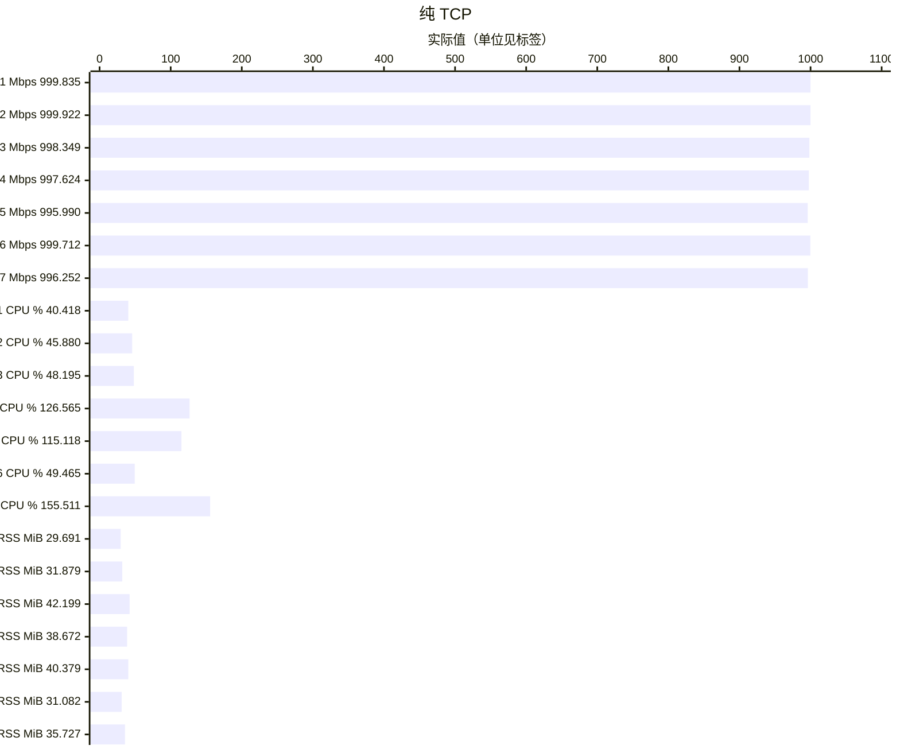
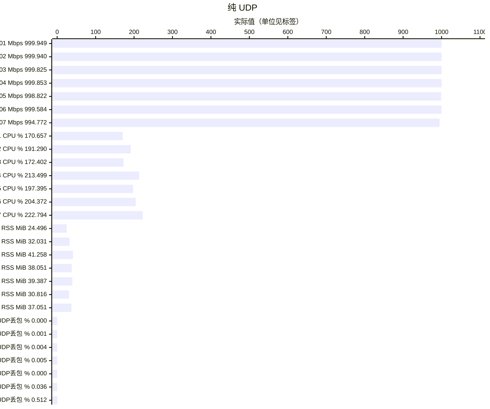
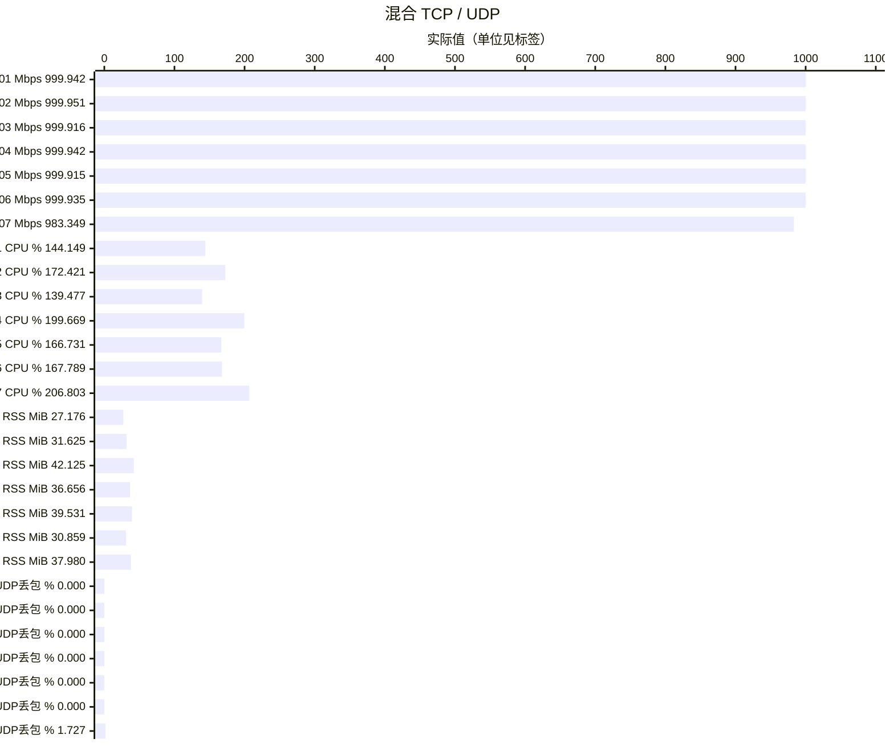

# TUN benchmark 最终结果

**主465项＋额外5项**按现行标准完成。主窗口最高RSS **42.80078125MiB**，接受窗口均≤43MiB；默认、严格Mihomo参考及多轮后相对阶段分别判断。结果由实际来源继承与受影响回归组成，不代表540项均在同一最终源码下通过。

- [完整470项四指标和18项匹配Mihomo参考](protocol-results.md)
- [压力验收最终结论](../conclusions/full-pressure-final.md)
- [已知问题及暂缓范围](known-issues.md)
- [互通、ABI和平台范围](mainline-validation.md)
- [验收策略](validation-strategy.md)

## 代表组合

以下仅展示七个组合的本轮最终值。Linux ARM64普通Release、真实TUN、Controller、完整CN GeoData、1Gbps／60秒。CPU100%为一核，RSS覆盖启动至Stop/reap。不同单位仅在同类指标内比较；纯TCP的UDP丢包为N/A，不画成零。

| 代号 | 组合 |
|---|---|
| P01 | `vless-tcp-none` |
| P02 | `vless-vision-reality` |
| P03 | `vless-xhttp-h1-tls-packet-up` |
| P04 | `vless-xhttp-h2-tls-stream-up` |
| P05 | `vless-xray-xhttp-h3-packet-up` |
| P06 | `2022-blake3-chacha20-poly1305` |
| P07 | `hysteria2-native-brutal-salamander` |

## 专项最终结论

- MetaDB国家匹配投影（Core c66757b对389fe56）在真实TUN六窗降低RSS 6.33–7.95MiB；CN匹配器计入常驻容量由8,423,579降至202,953字节，容量不等于进程RSS。1Gbps按当时参考通过，3Gbps仅签当时内存过载，不代签当前2Gbps或其他数据集。
- H2请求future装箱（6c3e3c2）将目标TCP RSS由43.08594降至42.80078MiB；三项受影响窗口通过，正文mixed RSS和三窗CPU代价保留，最终表见压力结论。
- XUDP发送编码分配减少，但未证明稳定的整进程RSS或CPU收益；少量1Gbps混合重复未复现持续CPU回归。
- [四类体验最终基线](experience-baseline.md)：日常与少量慢连接完整交付；高并发RSS45.50MiB仍FAIL，暂缓优化，不混入通过的470项。

本次清理不新增网络测试，不改写历史FAIL。原始过程已删除，最终文字、指标、已知边界与正式测试入口保留。
